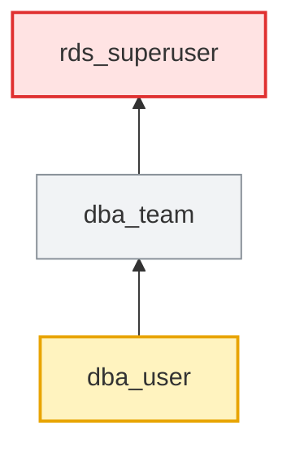

# Examples

Real troubleshooting scenarios. Every output below was captured from the test
fixture (`tests/fixture.sql`) on PostgreSQL 17.12 by `tests/make_examples.sh`.
All role, schema and table names are made up.

The fixture has, among others:

- `app_user → app_team → app_rw → app_read → app_base` (4 hops; `app_base` holds CONNECT)
- `report_user` (NOINHERIT) in `reporting`
- `fin_reader` with SELECT on `finance.ledger` but no USAGE on `finance`
- `hr_reader` with column grants on `hr.employees`
- `sales.orders` with row level security and one policy for `sales_emea`
- default privileges for `app_owner` in `sales`, but tables there are also created by `etl_owner`

## 1. Multi-level inheritance: where does the access come from?

`app_user` can read `sales.customers`, but nobody granted it anything directly. `access_why` names the role that holds each grant and the path to it.

```sql
SELECT step, check_name, result, detail
  FROM access_why('app_user', 'sales.customers', 'SELECT');
```

```text
 step |     check_name     | result |                                       detail
------+--------------------+--------+-------------------------------------------------------------------------------------
    0 | answer             | YES    | app_user can SELECT sales.customers
    1 | role               | PASS   | app_user: LOGIN
    2 | database CONNECT   | PASS   | granted by app_base [inherited: app_user → app_team → app_rw → app_read → app_base]
    3 | schema USAGE       | PASS   | granted by app_read [inherited: app_user → app_team → app_rw → app_read]
    4 | SELECT privilege   | PASS   | granted by app_read [inherited: app_user → app_team → app_rw → app_read]
    6 | row level security | PASS   | row level security is not enabled on this table
    7 | owner              | INFO   | sales.customers is owned by app_owner
(7 rows)
```

## 2. The whole chain in one call

Every role `app_user` belongs to, with the path and how each hop behaves. `server_confirms` is PostgreSQL's own `pg_has_role(..., 'USAGE')` answer.

```sql
SELECT depth, member_of, path, access, hop_inherit, hop_set
  FROM access_chain('app_user');
```

```text
 depth | member_of |                        path                        |  access   | hop_inherit | hop_set
-------+-----------+----------------------------------------------------+-----------+-------------+---------
     1 | app_team  | app_user → app_team                                | inherited | t           | t
     2 | app_rw    | app_user → app_team → app_rw                       | inherited | t           | t
     3 | app_read  | app_user → app_team → app_rw → app_read            | inherited | t           | t
     4 | app_base  | app_user → app_team → app_rw → app_read → app_base | inherited | t           | t
(4 rows)
```

## 3. Membership tree, both directions

Up: what `app_user` belongs to. Down: who sits under the group role `app_read`, login roles marked.

```sql
SELECT * FROM access_tree('app_user');
SELECT * FROM access_tree('app_read', 'down');
```

```text
              tree
--------------------------------
 app_user  (LOGIN, member of ↓)
 └── app_team
     └── app_rw
         └── app_read
             └── app_base
(5 rows)

              tree
--------------------------------
 app_read  (NOLOGIN, members ↓)
 ├── app_rw
 │   └── app_team
 │       └── app_user  [login]
 └── app_user2  [login]
(5 rows)
```

## 4. NOINHERIT breaks the chain

`report_user` is NOINHERIT. The grant is on `reporting`, so plain queries fail until the session runs `SET ROLE reporting`.

```sql
SELECT step, check_name, result, detail, suggested_fix
  FROM access_why('report_user', 'finance.ledger', 'SELECT');
```

```text
 step |     check_name     |       result        |                                                              detail                                                              |                                      suggested_fix
------+--------------------+---------------------+----------------------------------------------------------------------------------------------------------------------------------+------------------------------------------------------------------------------------------
    0 | answer             | ONLY AFTER SET ROLE | missing: USAGE on schema finance (held by reporting, not inherited), SELECT on finance.ledger (held by reporting, not inherited) | SET ROLE reporting;  -- or inherit it: GRANT reporting TO report_user WITH INHERIT TRUE;
    1 | role               | PASS                | report_user: LOGIN, NOINHERIT                                                                                                    |
    2 | database CONNECT   | PASS                | granted by report_user [direct grant]                                                                                            |
    3 | schema USAGE       | WARN                | USAGE on schema finance is held by reporting, which is not inherited: SET ROLE reporting first                                   | SET ROLE reporting;
    4 | SELECT privilege   | WARN                | granted to reporting (path report_user → reporting), but report_user does not inherit from reporting: SET ROLE reporting first   | SET ROLE reporting;  -- or inherit it: GRANT reporting TO report_user WITH INHERIT TRUE;
    6 | row level security | PASS                | row level security is not enabled on this table                                                                                  |
    7 | owner              | INFO                | finance.ledger is owned by postgres                                                                                              |
(7 rows)
```

## 5. Missing schema USAGE

`fin_reader` has SELECT on the table, but not USAGE on its schema, so it cannot even see the table.

```sql
SELECT step, check_name, result, detail, suggested_fix
  FROM access_why('fin_reader', 'finance.ledger', 'SELECT');
```

```text
 step |     check_name     | result |                                  detail                                   |                suggested_fix
------+--------------------+--------+---------------------------------------------------------------------------+----------------------------------------------
    0 | answer             | NO     | missing: USAGE on schema finance                                          | GRANT USAGE ON SCHEMA finance TO fin_reader;
    1 | role               | PASS   | fin_reader: LOGIN                                                         |
    2 | database CONNECT   | PASS   | granted by fin_reader [direct grant]                                      |
    3 | schema USAGE       | FAIL   | no usable USAGE on schema finance: the role cannot even see objects in it | GRANT USAGE ON SCHEMA finance TO fin_reader;
    4 | SELECT privilege   | PASS   | granted by fin_reader [direct grant]                                      |
    6 | row level security | PASS   | row level security is not enabled on this table                           |
    7 | owner              | INFO   | finance.ledger is owned by postgres                                       |
(7 rows)
```

## 6. Column grants: SELECT * fails, named columns work

```sql
SELECT step, check_name, result, detail
  FROM access_why('hr_reader', 'hr.employees', 'SELECT');
```

```text
 step |     check_name     |    result    |                                        detail
------+--------------------+--------------+--------------------------------------------------------------------------------------
    0 | answer             | COLUMNS ONLY | missing: SELECT on hr.employees (only columns id, name, dept)
    1 | role               | PASS         | hr_reader: LOGIN
    2 | database CONNECT   | PASS         | granted by hr_reader [direct grant]
    3 | schema USAGE       | PASS         | granted by hr_reader [direct grant]
    4 | SELECT privilege   | FAIL         | no SELECT grant to hr_reader, to any role it inherits, or to PUBLIC
    5 | column grants      | WARN         | SELECT is granted on columns id, name, dept only; SELECT * and unlisted columns fail
    6 | row level security | PASS         | row level security is not enabled on this table
    7 | owner              | INFO         | hr.employees is owned by postgres
(8 rows)
```

## 7. Row level security hides rows (no error)

`sales_apac` has SELECT on `sales.orders` but no policy applies to it, so it silently gets zero rows. `sales_emea` is filtered by its policy.

```sql
SELECT object, check_name, result, detail
  FROM access_why('sales_apac', 'sales.orders', 'SELECT') WHERE check_name IN ('answer', 'row level security')
UNION ALL
SELECT object, check_name, result, detail
  FROM access_why('sales_emea', 'sales.orders', 'SELECT') WHERE check_name IN ('answer', 'row level security');
```

```text
    object    |     check_name     |            result            |                                                        detail
--------------+--------------------+------------------------------+-----------------------------------------------------------------------------------------------------------------------
 sales.orders | answer             | YES, BUT RLS BLOCKS ALL ROWS | sales_apac can SELECT sales.orders
 sales.orders | row level security | FAIL                         | RLS is enabled and no permissive SELECT policy applies to this role: it sees / affects zero rows (no error is raised)
 sales.orders | answer             | YES, RLS FILTERS ROWS        | sales_emea can SELECT sales.orders
 sales.orders | row level security | WARN                         | RLS is enabled: rows are limited to policies emea_only USING ((region = 'EMEA'::text))
(4 rows)
```

## 8. New tables are not readable: default privileges for a different creator

`app_owner`'s new tables in `sales` are covered by default privileges. `etl_owner` and `sales_owner` also create tables there, and theirs are not covered. The suggested grantee is the role in the chain that already holds SELECT on most tables in that schema.

```sql
SELECT creator_role, schema_name, object_type, privileges, grantee, how, note
  FROM access_default_privileges('app_user');
```

```text
 creator_role  |  schema_name  | object_type | privileges | grantee  |     how     |                                                                                        note
---------------+---------------+-------------+------------+----------+-------------+-------------------------------------------------------------------------------------------------------------------------------------------------------------------------------------
 app_owner     | sales         | tables      | SELECT     | app_read | inherited   | via app_user → app_team → app_rw → app_read
 etl_owner     | sales         | tables      |            |          | NOT COVERED | new tables created by etl_owner in sales will NOT be readable by app_user. Fix: ALTER DEFAULT PRIVILEGES FOR ROLE etl_owner IN SCHEMA sales GRANT SELECT ON TABLES TO app_read;
 ghost_creator | (all schemas) | tables      | SELECT     | app_read | inherited   | via app_user → app_team → app_rw → app_read
 sales_owner   | sales         | tables      |            |          | NOT COVERED | new tables created by sales_owner in sales will NOT be readable by app_user. Fix: ALTER DEFAULT PRIVILEGES FOR ROLE sales_owner IN SCHEMA sales GRANT SELECT ON TABLES TO app_read;
(4 rows)
```

## 9. Explain a permission-denied error

Paste the error, plus the STATEMENT line from the server log if you have it. The fix is returned as text and is never run.

```sql
SELECT * FROM access_explain_error(
  'ERROR:  permission denied for table orders
   STATEMENT:  INSERT INTO sales.orders (region, amount) VALUES (''EMEA'', 10)',
  'app_user2');
```

```text
 step |                finding                 |                               detail                                |                  suggested_fix
------+----------------------------------------+---------------------------------------------------------------------+--------------------------------------------------
    1 | parsed                                 | missing privilege on table orders, checked for role app_user2       |
    2 | object                                 | sales.orders (table)                                                |
    3 | action                                 | INSERT (taken from the STATEMENT)                                   |
    4 | INSERT privilege on sales.orders: FAIL | no INSERT grant to app_user2, to any role it inherits, or to PUBLIC | GRANT INSERT ON TABLE sales.orders TO app_user2;
    5 | fix (review, then run it yourself)     |                                                                     | GRANT INSERT ON TABLE sales.orders TO app_user2;
(5 rows)
```

## 10. Explain an error when the action is ambiguous

Without the statement, the message does not say which privilege was missing. The function lists what the role has and lacks, and still finds the real blocker (schema USAGE).

```sql
SELECT * FROM access_explain_error('ERROR:  permission denied for table ledger', 'fin_reader');
```

```text
 step |              finding               |                                                                                                                  detail                                                                                                                  |                                                                    suggested_fix
------+------------------------------------+------------------------------------------------------------------------------------------------------------------------------------------------------------------------------------------------------------------------------------------+------------------------------------------------------------------------------------------------------------------------------------------------------
    1 | parsed                             | missing privilege on table ledger, checked for role fin_reader                                                                                                                                                                           |
    2 | object                             | finance.ledger (table)                                                                                                                                                                                                                   |
    3 | action                             | ambiguous: the message does not name the action. fin_reader has: SELECT; fin_reader lacks: INSERT, UPDATE, DELETE, TRUNCATE, REFERENCES, TRIGGER. Pass the action as the 3rd argument, or include the STATEMENT: line, to narrow it down |
    4 | schema USAGE: FAIL                 | no usable USAGE on schema finance: the role cannot even see objects in it                                                                                                                                                                | GRANT USAGE ON SCHEMA finance TO fin_reader;
    5 | fix (review, then run it yourself) | the action is a guess list: pick one before running                                                                                                                                                                                      | GRANT USAGE ON SCHEMA finance TO fin_reader;                                                                                                        +
      |                                    |                                                                                                                                                                                                                                          | GRANT INSERT | UPDATE | DELETE | TRUNCATE | REFERENCES | TRIGGER ON TABLE finance.ledger TO fin_reader;  -- keep only the action the statement needs
(5 rows)
```

## 11. Compare two app users

Why can `app_user` write `sales.orders` when `app_user2` can't? Only differences are listed.

```sql
SELECT * FROM access_compare('app_user', 'app_user2');
```

```text
  category  |                     item                      |                  role_a                  | role_b
------------+-----------------------------------------------+------------------------------------------+--------
 membership | app_rw                                        | inherited (app_user → app_team → app_rw) | -
 membership | app_team                                      | inherited (app_user → app_team)          | -
 privilege  | EXECUTE on function sales.calc_total(integer) | yes via app_rw [inherited]               | -
 privilege  | INSERT on table sales.orders                  | yes via app_rw [inherited]               | -
 privilege  | UPDATE on table sales.orders                  | yes via app_rw [inherited]               | -
 privilege  | USAGE on sequence sales.orders_id_seq         | yes via app_rw [inherited]               | -
(6 rows)
```

## 12. Who can read this table?

```sql
SELECT role_name, can_login, result, via, missing
  FROM access_who_can('finance.ledger', 'SELECT');
```

```text
  role_name   | can_login |       result        |                              via                               |              missing
--------------+-----------+---------------------+----------------------------------------------------------------+------------------------------------
 auditor      | t         | YES                 | pg_read_all_data [predefined role: auditor → pg_read_all_data] |
 fin_reader   | t         | BLOCKED             | fin_reader [direct grant]                                      | USAGE on schema finance
 legacy_admin | t         | ONLY AFTER SET ROLE | SET ROLE legacy_su                                             |
 legacy_su    | f         | YES                 | legacy_su [superuser]                                          |
 postgres     | t         | YES                 | postgres [owner]; postgres [superuser]                         |
 report_user  | t         | ONLY AFTER SET ROLE | SET ROLE reporting                                             |
 reporting    | f         | BLOCKED             | reporting [direct grant]                                       | CONNECT on database inspector_test
(7 rows)
```

## 13. Red flags for every role

```sql
SELECT role_name, severity, flag, detail FROM access_red_flags();
```

```text
   role_name    | severity |            flag            |                                                       detail
----------------+----------+----------------------------+--------------------------------------------------------------------------------------------------------------------
 dba_team       | HIGH     | rds_superuser in chain     | inherits rds_superuser through dba_team → rds_superuser
 dba_user       | HIGH     | rds_superuser in chain     | inherits rds_superuser through dba_user → dba_team → rds_superuser
 legacy_admin   | HIGH     | superuser via membership   | can SET ROLE legacy_su (a superuser) through legacy_admin → legacy_su
 legacy_su      | HIGH     | SUPERUSER                  | bypasses every privilege check, RLS included
 locked_user    | HIGH     | connection limit 0         | CONNECTION LIMIT 0: every login is refused
 nocon_user     | HIGH     | cannot CONNECT             | login role without CONNECT on database inspector_test
 old_contractor | HIGH     | password expired           | VALID UNTIL 2020-01-01 00:00:00+00 is in the past: password logins fail
 auditor        | MEDIUM   | reads/writes all data      | inherits pg_read_all_data through auditor → pg_read_all_data
 ops_user       | MEDIUM   | NOINHERIT breaks the chain | privileges of ops_admin are not inherited (path ops_user → ops_admin); they apply only after SET ROLE ops_admin
 ops_user       | MEDIUM   | membership grants nothing  | member of dead_end with neither INHERIT nor SET (path ops_user → dead_end)
 report_user    | MEDIUM   | NOINHERIT breaks the chain | privileges of reporting are not inherited (path report_user → reporting); they apply only after SET ROLE reporting
 rls_admin      | MEDIUM   | BYPASSRLS                  | ignores every row level security policy
 app_owner      | INFO     | NOLOGIN                    | NOLOGIN and no members: grants to it reach nobody (expected for an owner-only role)
 etl_owner      | INFO     | NOLOGIN                    | NOLOGIN and no members: grants to it reach nobody (expected for an owner-only role)
 ghost_creator  | INFO     | NOLOGIN                    | NOLOGIN and no members: grants to it reach nobody (expected for an owner-only role)
 orphan_group   | INFO     | NOLOGIN                    | NOLOGIN and no members: grants to it reach nobody (expected for an owner-only role)
 postgres       | INFO     | SUPERUSER                  | bypasses every privilege check, RLS included (bootstrap superuser, expected)
 rds_superuser  | INFO     | CREATEROLE                 | can create roles (and before PG16, grant itself almost any role) (managed by AWS RDS)
 sales_owner    | INFO     | NOLOGIN                    | NOLOGIN and no members: grants to it reach nobody (expected for an owner-only role)
(19 rows)
```

## 14. Risky access finder

Database-wide. `3` is the chain depth above which login roles are reported.

```sql
SELECT severity, category, name, detail FROM access_risky(3);
```

```text
 severity |       category       |          name          |                                                                    detail
----------+----------------------+------------------------+----------------------------------------------------------------------------------------------------------------------------------------------
 HIGH     | PUBLIC grant         | audit.events           | PUBLIC (every role) has INSERT on table audit.events
 HIGH     | PUBLIC grant         | public.reset_counter() | SECURITY DEFINER function owned by postgres is executable by PUBLIC
 HIGH     | rds_superuser member | dba_team               | inherits rds_superuser: dba_team → rds_superuser
 HIGH     | rds_superuser member | dba_user               | inherits rds_superuser: dba_user → dba_team → rds_superuser
 HIGH     | role attribute       | legacy_su              | SUPERUSER
 MEDIUM   | PUBLIC grant         | sales.price_list       | PUBLIC (every role) has SELECT on table sales.price_list
 MEDIUM   | role attribute       | rls_admin              | BYPASSRLS (login role)
 LOW      | PUBLIC grant         | audit                  | PUBLIC has USAGE on schema audit
 LOW      | deep chain           | app_user               | membership chain is 4 levels deep (limit 3): app_user → app_team → app_rw → app_read → app_base
 LOW      | default privileges   | ghost_creator          | creator ghost_creator owns no tables in any schema yet, so these defaults have not applied to anything: check the right role creates objects
 INFO     | role attribute       | postgres               | SUPERUSER (login role) - bootstrap superuser, expected
 INFO     | role attribute       | rds_superuser          | CREATEDB - managed by AWS RDS
 INFO     | role attribute       | rds_superuser          | CREATEROLE - managed by AWS RDS
 INFO     | unused login roles   | (skipped)              | PostgreSQL does not record last login time; use log_connections, pgAudit or CloudWatch logs (RDS) to find unused logins
(14 rows)
```

## 15. Mermaid diagram for a ticket

Paste the text into any Mermaid renderer (GitHub, Confluence, mermaid.live).

```sql
SELECT access_tree_mermaid('dba_user');
```



## 16. No-install version

Same main checks with nothing created, for databases where you cannot install functions. Section 2 of the output:

```sh
psql -X -d inspector_test -v role=report_user -v object=finance.ledger -v action=SELECT -f psql/access_checks.sql
```

```text
== 2. Can report_user do SELECT on finance.ledger ?
     object     |     check_name     | result |                  detail
----------------+--------------------+--------+-------------------------------------------
 finance.ledger | privilege SELECT   | NO     | grants found: reporting [needs SET ROLE]
 finance.ledger | schema USAGE       | NO     | schema finance
 finance.ledger | database CONNECT   | YES    | database inspector_test
 finance.ledger | column grants      | none   | columns the role can use with this action
 finance.ledger | row level security | off    | -
 finance.ledger | role               | LOGIN  | NOINHERIT
(6 rows)
```
