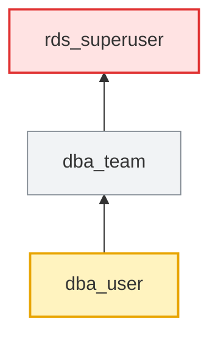

# Examples

Real troubleshooting scenarios. Every output below was captured from the test
fixture (`tests/fixture.sql`) on PostgreSQL 17.12 by `tests/make_examples.sh`.
All role, schema and table names are made up.

The fixture has, among others:

- `app_user → app_team → app_rw → app_read → app_base` (4 hops; `app_base` holds CONNECT)
- `report_user` (NOINHERIT) in `reporting`
- `fin_reader` with SELECT on `finance.ledger` but no USAGE on `finance`
- `hr_reader` with column grants on `hr.employees`
- `sales.orders` with row level security and one policy for `sales_emea`
- default privileges for `app_owner` in `sales`, but tables there are also created by `etl_owner`
- `acme_clerk → acme_rw → acme_ro` (plus a direct `acme_clerk → acme_ro`) with grants in schemas `billing` and `billing_arch`
- schema `cfg` with audit triggers: `cfg.fn_config_audit_trg()` is SECURITY DEFINER and its owner `audit_owner` has no USAGE on `cfg`; `cfg.fn_flag_audit_trg()` is SECURITY INVOKER and the caller `cfg_user` cannot insert into its audit table

## 1. Multi-level inheritance: where does the access come from?

`app_user` can read `sales.customers`, but nobody granted it anything directly. `access_why` names the role that holds each grant and the path to it.

```sql
SELECT step, check_name, result, detail
  FROM access_why('app_user', 'sales.customers', 'SELECT');
```

```text
 step |     check_name     | result |                                       detail
------+--------------------+--------+-------------------------------------------------------------------------------------
    0 | answer             | YES    | app_user can SELECT sales.customers
    1 | role               | PASS   | app_user: LOGIN
    2 | database CONNECT   | PASS   | granted by app_base [inherited: app_user → app_team → app_rw → app_read → app_base]
    3 | schema USAGE       | PASS   | granted by app_read [inherited: app_user → app_team → app_rw → app_read]
    4 | SELECT privilege   | PASS   | granted by app_read [inherited: app_user → app_team → app_rw → app_read]
    6 | row level security | PASS   | row level security is not enabled on this table
    7 | owner              | INFO   | sales.customers is owned by app_owner
(7 rows)
```

## 2. The whole chain in one call

Every role `app_user` belongs to, with the path and how each hop behaves. `server_confirms` is PostgreSQL's own `pg_has_role(..., 'USAGE')` answer.

```sql
SELECT depth, member_of, path, access, hop_inherit, hop_set
  FROM access_chain('app_user');
```

```text
 depth | member_of |                        path                        |  access   | hop_inherit | hop_set
-------+-----------+----------------------------------------------------+-----------+-------------+---------
     1 | app_team  | app_user → app_team                                | inherited | t           | t
     2 | app_rw    | app_user → app_team → app_rw                       | inherited | t           | t
     3 | app_read  | app_user → app_team → app_rw → app_read            | inherited | t           | t
     4 | app_base  | app_user → app_team → app_rw → app_read → app_base | inherited | t           | t
(4 rows)
```

## 3. Membership tree, both directions

Up: what `app_user` belongs to. Down: who sits under the group role `app_read`, login roles marked.

```sql
SELECT * FROM access_tree('app_user');
SELECT * FROM access_tree('app_read', 'down');
```

```text
              tree
--------------------------------
 app_user  (LOGIN, member of ↓)
 └── app_team
     └── app_rw
         └── app_read
             └── app_base
(5 rows)

              tree
--------------------------------
 app_read  (NOLOGIN, members ↓)
 ├── app_rw
 │   └── app_team
 │       └── app_user  [login]
 └── app_user2  [login]
(5 rows)
```

## 4. NOINHERIT breaks the chain

`report_user` is NOINHERIT. The grant is on `reporting`, so plain queries fail until the session runs `SET ROLE reporting`.

```sql
SELECT step, check_name, result, detail, suggested_fix
  FROM access_why('report_user', 'finance.ledger', 'SELECT');
```

```text
 step |     check_name     |       result        |                                                              detail                                                              |                                      suggested_fix
------+--------------------+---------------------+----------------------------------------------------------------------------------------------------------------------------------+------------------------------------------------------------------------------------------
    0 | answer             | ONLY AFTER SET ROLE | missing: USAGE on schema finance (held by reporting, not inherited), SELECT on finance.ledger (held by reporting, not inherited) | SET ROLE reporting;  -- or inherit it: GRANT reporting TO report_user WITH INHERIT TRUE;
    1 | role               | PASS                | report_user: LOGIN, NOINHERIT                                                                                                    |
    2 | database CONNECT   | PASS                | granted by report_user [direct grant]                                                                                            |
    3 | schema USAGE       | WARN                | USAGE on schema finance is held by reporting, which is not inherited: SET ROLE reporting first                                   | SET ROLE reporting;
    4 | SELECT privilege   | WARN                | granted to reporting (path report_user → reporting), but report_user does not inherit from reporting: SET ROLE reporting first   | SET ROLE reporting;  -- or inherit it: GRANT reporting TO report_user WITH INHERIT TRUE;
    6 | row level security | PASS                | row level security is not enabled on this table                                                                                  |
    7 | owner              | INFO                | finance.ledger is owned by postgres                                                                                              |
(7 rows)
```

## 5. Missing schema USAGE

`fin_reader` has SELECT on the table, but not USAGE on its schema, so it cannot even see the table.

```sql
SELECT step, check_name, result, detail, suggested_fix
  FROM access_why('fin_reader', 'finance.ledger', 'SELECT');
```

```text
 step |     check_name     | result |                                  detail                                   |                suggested_fix
------+--------------------+--------+---------------------------------------------------------------------------+----------------------------------------------
    0 | answer             | NO     | missing: USAGE on schema finance                                          | GRANT USAGE ON SCHEMA finance TO fin_reader;
    1 | role               | PASS   | fin_reader: LOGIN                                                         |
    2 | database CONNECT   | PASS   | granted by fin_reader [direct grant]                                      |
    3 | schema USAGE       | FAIL   | no usable USAGE on schema finance: the role cannot even see objects in it | GRANT USAGE ON SCHEMA finance TO fin_reader;
    4 | SELECT privilege   | PASS   | granted by fin_reader [direct grant]                                      |
    6 | row level security | PASS   | row level security is not enabled on this table                           |
    7 | owner              | INFO   | finance.ledger is owned by postgres                                       |
(7 rows)
```

## 6. Column grants: SELECT * fails, named columns work

```sql
SELECT step, check_name, result, detail
  FROM access_why('hr_reader', 'hr.employees', 'SELECT');
```

```text
 step |     check_name     |    result    |                                        detail
------+--------------------+--------------+--------------------------------------------------------------------------------------
    0 | answer             | COLUMNS ONLY | missing: SELECT on hr.employees (only columns id, name, dept)
    1 | role               | PASS         | hr_reader: LOGIN
    2 | database CONNECT   | PASS         | granted by hr_reader [direct grant]
    3 | schema USAGE       | PASS         | granted by hr_reader [direct grant]
    4 | SELECT privilege   | FAIL         | no SELECT grant to hr_reader, to any role it inherits, or to PUBLIC
    5 | column grants      | WARN         | SELECT is granted on columns id, name, dept only; SELECT * and unlisted columns fail
    6 | row level security | PASS         | row level security is not enabled on this table
    7 | owner              | INFO         | hr.employees is owned by postgres
(8 rows)
```

## 7. Row level security hides rows (no error)

`sales_apac` has SELECT on `sales.orders` but no policy applies to it, so it silently gets zero rows. `sales_emea` is filtered by its policy.

```sql
SELECT object, check_name, result, detail
  FROM access_why('sales_apac', 'sales.orders', 'SELECT') WHERE check_name IN ('answer', 'row level security')
UNION ALL
SELECT object, check_name, result, detail
  FROM access_why('sales_emea', 'sales.orders', 'SELECT') WHERE check_name IN ('answer', 'row level security');
```

```text
    object    |     check_name     |            result            |                                                        detail
--------------+--------------------+------------------------------+-----------------------------------------------------------------------------------------------------------------------
 sales.orders | answer             | YES, BUT RLS BLOCKS ALL ROWS | sales_apac can SELECT sales.orders
 sales.orders | row level security | FAIL                         | RLS is enabled and no permissive SELECT policy applies to this role: it sees / affects zero rows (no error is raised)
 sales.orders | answer             | YES, RLS FILTERS ROWS        | sales_emea can SELECT sales.orders
 sales.orders | row level security | WARN                         | RLS is enabled: rows are limited to policies emea_only USING ((region = 'EMEA'::text))
(4 rows)
```

## 8. New tables are not readable: default privileges for a different creator

`app_owner`'s new tables in `sales` are covered by default privileges. `etl_owner` and `sales_owner` also create tables there, and theirs are not covered. The suggested grantee is the role in the chain that already holds SELECT on most tables in that schema.

```sql
SELECT creator_role, schema_name, object_type, privileges, grantee, how, note
  FROM access_default_privileges('app_user');
```

```text
 creator_role  |  schema_name  | object_type | privileges | grantee  |     how     |                                                                                        note
---------------+---------------+-------------+------------+----------+-------------+-------------------------------------------------------------------------------------------------------------------------------------------------------------------------------------
 app_owner     | sales         | tables      | SELECT     | app_read | inherited   | via app_user → app_team → app_rw → app_read
 etl_owner     | sales         | tables      |            |          | NOT COVERED | new tables created by etl_owner in sales will NOT be readable by app_user. Fix: ALTER DEFAULT PRIVILEGES FOR ROLE etl_owner IN SCHEMA sales GRANT SELECT ON TABLES TO app_read;
 ghost_creator | (all schemas) | tables      | SELECT     | app_read | inherited   | via app_user → app_team → app_rw → app_read
 sales_owner   | sales         | tables      |            |          | NOT COVERED | new tables created by sales_owner in sales will NOT be readable by app_user. Fix: ALTER DEFAULT PRIVILEGES FOR ROLE sales_owner IN SCHEMA sales GRANT SELECT ON TABLES TO app_read;
(4 rows)
```

## 9. Explain a permission-denied error

Paste the error, plus the STATEMENT line from the server log if you have it. The fix is returned as text and is never run.

```sql
SELECT * FROM access_explain_error(
  'ERROR:  permission denied for table orders
   STATEMENT:  INSERT INTO sales.orders (region, amount) VALUES (''EMEA'', 10)',
  'app_user2');
```

```text
 step |                finding                 |                               detail                                |                  suggested_fix
------+----------------------------------------+---------------------------------------------------------------------+--------------------------------------------------
    1 | parsed                                 | missing privilege on table orders, checked for role app_user2       |
    2 | object                                 | sales.orders (table)                                                |
    3 | action                                 | INSERT (taken from the STATEMENT)                                   |
    4 | INSERT privilege on sales.orders: FAIL | no INSERT grant to app_user2, to any role it inherits, or to PUBLIC | GRANT INSERT ON TABLE sales.orders TO app_user2;
    5 | fix (review, then run it yourself)     |                                                                     | GRANT INSERT ON TABLE sales.orders TO app_user2;
(5 rows)
```

## 10. Explain an error when the action is ambiguous

Without the statement, the message does not say which privilege was missing. The function lists what the role has and lacks, and still finds the real blocker (schema USAGE).

```sql
SELECT * FROM access_explain_error('ERROR:  permission denied for table ledger', 'fin_reader');
```

```text
 step |              finding               |                                                                                                                  detail                                                                                                                  |                                                                    suggested_fix
------+------------------------------------+------------------------------------------------------------------------------------------------------------------------------------------------------------------------------------------------------------------------------------------+------------------------------------------------------------------------------------------------------------------------------------------------------
    1 | parsed                             | missing privilege on table ledger, checked for role fin_reader                                                                                                                                                                           |
    2 | object                             | finance.ledger (table)                                                                                                                                                                                                                   |
    3 | action                             | ambiguous: the message does not name the action. fin_reader has: SELECT; fin_reader lacks: INSERT, UPDATE, DELETE, TRUNCATE, REFERENCES, TRIGGER. Pass the action as the 3rd argument, or include the STATEMENT: line, to narrow it down |
    4 | schema USAGE: FAIL                 | no usable USAGE on schema finance: the role cannot even see objects in it                                                                                                                                                                | GRANT USAGE ON SCHEMA finance TO fin_reader;
    5 | fix (review, then run it yourself) | the action is a guess list: pick one before running                                                                                                                                                                                      | GRANT USAGE ON SCHEMA finance TO fin_reader;                                                                                                        +
      |                                    |                                                                                                                                                                                                                                          | GRANT INSERT | UPDATE | DELETE | TRUNCATE | REFERENCES | TRIGGER ON TABLE finance.ledger TO fin_reader;  -- keep only the action the statement needs
(5 rows)
```

## 11. Compare two app users

Why can `app_user` write `sales.orders` when `app_user2` can't? Only differences are listed.

```sql
SELECT * FROM access_compare('app_user', 'app_user2');
```

```text
  category  |                     item                      |                  role_a                  | role_b
------------+-----------------------------------------------+------------------------------------------+--------
 membership | app_rw                                        | inherited (app_user → app_team → app_rw) | -
 membership | app_team                                      | inherited (app_user → app_team)          | -
 privilege  | EXECUTE on function sales.calc_total(integer) | yes via app_rw [inherited]               | -
 privilege  | INSERT on table sales.orders                  | yes via app_rw [inherited]               | -
 privilege  | UPDATE on table sales.orders                  | yes via app_rw [inherited]               | -
 privilege  | USAGE on sequence sales.orders_id_seq         | yes via app_rw [inherited]               | -
(6 rows)
```

## 12. Who can read this table?

```sql
SELECT role_name, can_login, result, via, missing
  FROM access_who_can('finance.ledger', 'SELECT');
```

```text
  role_name   | can_login |       result        |                              via                               |              missing
--------------+-----------+---------------------+----------------------------------------------------------------+------------------------------------
 auditor      | t         | YES                 | pg_read_all_data [predefined role: auditor → pg_read_all_data] |
 fin_reader   | t         | BLOCKED             | fin_reader [direct grant]                                      | USAGE on schema finance
 legacy_admin | t         | ONLY AFTER SET ROLE | SET ROLE legacy_su                                             |
 legacy_su    | f         | YES                 | legacy_su [superuser]                                          |
 postgres     | t         | YES                 | postgres [owner]; postgres [superuser]                         |
 report_user  | t         | ONLY AFTER SET ROLE | SET ROLE reporting                                             |
 reporting    | f         | BLOCKED             | reporting [direct grant]                                       | CONNECT on database inspector_test
(7 rows)
```

## 13. Red flags for every role

```sql
SELECT role_name, severity, flag, detail FROM access_red_flags();
```

```text
   role_name    | severity |            flag            |                                                        detail
----------------+----------+----------------------------+-----------------------------------------------------------------------------------------------------------------------
 dba_team       | HIGH     | rds_superuser in chain     | inherits rds_superuser through dba_team → rds_superuser
 dba_user       | HIGH     | rds_superuser in chain     | inherits rds_superuser through dba_user → dba_team → rds_superuser
 legacy_admin   | HIGH     | superuser via membership   | can SET ROLE legacy_su (a superuser) through legacy_admin → legacy_su
 legacy_su      | HIGH     | SUPERUSER                  | bypasses every privilege check, RLS included
 locked_user    | HIGH     | connection limit 0         | CONNECTION LIMIT 0: every login is refused
 nocon_user     | HIGH     | cannot CONNECT             | login role without CONNECT on database inspector_test
 old_contractor | HIGH     | password expired           | VALID UNTIL 2020-01-01 00:00:00+00 is in the past: password logins fail
 acme_clerk     | MEDIUM   | NOINHERIT breaks the chain | privileges of acme_admin are not inherited (path acme_clerk → acme_admin); they apply only after SET ROLE acme_admin
 auditor        | MEDIUM   | reads/writes all data      | inherits pg_read_all_data through auditor → pg_read_all_data
 noinh_owner    | MEDIUM   | NOINHERIT breaks the chain | privileges of cfg_writer are not inherited (path noinh_owner → cfg_writer); they apply only after SET ROLE cfg_writer
 ops_user       | MEDIUM   | NOINHERIT breaks the chain | privileges of ops_admin are not inherited (path ops_user → ops_admin); they apply only after SET ROLE ops_admin
 ops_user       | MEDIUM   | membership grants nothing  | member of dead_end with neither INHERIT nor SET (path ops_user → dead_end)
 report_user    | MEDIUM   | NOINHERIT breaks the chain | privileges of reporting are not inherited (path report_user → reporting); they apply only after SET ROLE reporting
 rls_admin      | MEDIUM   | BYPASSRLS                  | ignores every row level security policy
 app_owner      | INFO     | NOLOGIN                    | NOLOGIN and no members: grants to it reach nobody (expected for an owner-only role)
 audit_owner    | INFO     | NOLOGIN                    | NOLOGIN and no members: grants to it reach nobody (expected for an owner-only role)
 billing_owner  | INFO     | NOLOGIN                    | NOLOGIN and no members: grants to it reach nobody (expected for an owner-only role)
 cfg_owner      | INFO     | NOLOGIN                    | NOLOGIN and no members: grants to it reach nobody (expected for an owner-only role)
 etl_owner      | INFO     | NOLOGIN                    | NOLOGIN and no members: grants to it reach nobody (expected for an owner-only role)
 ghost_creator  | INFO     | NOLOGIN                    | NOLOGIN and no members: grants to it reach nobody (expected for an owner-only role)
 noinh_owner    | INFO     | NOLOGIN                    | NOLOGIN and no members: grants to it reach nobody (expected for an owner-only role)
 orphan_group   | INFO     | NOLOGIN                    | NOLOGIN and no members: grants to it reach nobody (expected for an owner-only role)
 postgres       | INFO     | SUPERUSER                  | bypasses every privilege check, RLS included (bootstrap superuser, expected)
 rds_superuser  | INFO     | CREATEROLE                 | can create roles (and before PG16, grant itself almost any role) (managed by AWS RDS)
 sales_owner    | INFO     | NOLOGIN                    | NOLOGIN and no members: grants to it reach nobody (expected for an owner-only role)
(25 rows)
```

## 14. Risky access finder

Database-wide. `3` is the chain depth above which login roles are reported.

```sql
SELECT severity, category, name, detail FROM access_risky(3);
```

```text
 severity |       category       |          name           |                                                                    detail
----------+----------------------+-------------------------+----------------------------------------------------------------------------------------------------------------------------------------------
 HIGH     | PUBLIC grant         | audit.events            | PUBLIC (every role) has INSERT on table audit.events
 HIGH     | PUBLIC grant         | cfg.fn_count_flags()    | SECURITY DEFINER function owned by cfg_owner is executable by PUBLIC
 HIGH     | PUBLIC grant         | cfg.fn_log_change(text) | SECURITY DEFINER function owned by noinh_owner is executable by PUBLIC
 HIGH     | PUBLIC grant         | cfg.fn_next_change_id() | SECURITY DEFINER function owned by cfg_owner is executable by PUBLIC
 HIGH     | PUBLIC grant         | public.reset_counter()  | SECURITY DEFINER function owned by postgres is executable by PUBLIC
 HIGH     | rds_superuser member | dba_team                | inherits rds_superuser: dba_team → rds_superuser
 HIGH     | rds_superuser member | dba_user                | inherits rds_superuser: dba_user → dba_team → rds_superuser
 HIGH     | role attribute       | legacy_su               | SUPERUSER
 MEDIUM   | PUBLIC grant         | billing.rates           | PUBLIC (every role) has SELECT on table billing.rates
 MEDIUM   | PUBLIC grant         | sales.price_list        | PUBLIC (every role) has SELECT on table sales.price_list
 MEDIUM   | role attribute       | rls_admin               | BYPASSRLS (login role)
 LOW      | PUBLIC grant         | audit                   | PUBLIC has USAGE on schema audit
 LOW      | deep chain           | app_user                | membership chain is 4 levels deep (limit 3): app_user → app_team → app_rw → app_read → app_base
 LOW      | default privileges   | ghost_creator           | creator ghost_creator owns no tables in any schema yet, so these defaults have not applied to anything: check the right role creates objects
 LOW      | role attribute       | acme_admin              | CREATEDB
 INFO     | role attribute       | postgres                | SUPERUSER (login role) - bootstrap superuser, expected
 INFO     | role attribute       | rds_superuser           | CREATEDB - managed by AWS RDS
 INFO     | role attribute       | rds_superuser           | CREATEROLE - managed by AWS RDS
 INFO     | unused login roles   | (skipped)               | PostgreSQL does not record last login time; use log_connections, pgAudit or CloudWatch logs (RDS) to find unused logins
(19 rows)
```

## 15. Mermaid diagram for a ticket

Paste the text into any Mermaid renderer (GitHub, Confluence, mermaid.live).

```sql
SELECT access_tree_mermaid('dba_user');
```



## 16. No-install version

Same main checks with nothing created, for databases where you cannot install functions. Section 2 of the output:

```sh
psql -X -d inspector_test -v role=report_user -v object=finance.ledger -v action=SELECT -f psql/access_checks.sql
```

```text
== 2. Can report_user do SELECT on finance.ledger ?
     object     |     check_name     | result |                  detail
----------------+--------------------+--------+-------------------------------------------
 finance.ledger | privilege SELECT   | NO     | grants found: reporting [needs SET ROLE]
 finance.ledger | schema USAGE       | NO     | schema finance
 finance.ledger | database CONNECT   | YES    | database inspector_test
 finance.ledger | column grants      | none   | columns the role can use with this action
 finance.ledger | row level security | off    | -
 finance.ledger | role               | LOGIN  | NOINHERIT
(6 rows)
```

## 17. Error inside a SECURITY DEFINER trigger: the owner is missing the privilege

A made-up copy of a real case. `cfg_user` can update `cfg.app_config`, but the UPDATE fires the audit trigger `cfg.fn_config_audit_trg()`, which is SECURITY DEFINER. Its owner `audit_owner` has INSERT on `cfg.config_audit` but no USAGE on schema `cfg`. The error psql printed for `UPDATE cfg.app_config SET value = '60' WHERE key = 'timeout'`:

```text
ERROR:  permission denied for schema cfg
LINE 1: INSERT INTO cfg.config_audit (key, old_value, new_value, cha...
                    ^
QUERY:  INSERT INTO cfg.config_audit (key, old_value, new_value, changed_by)
  VALUES (NEW.key, v_old, v_new, session_user)
CONTEXT:  PL/pgSQL function cfg.fn_config_audit_trg() line 13 at SQL statement
```

Paste all of it, CONTEXT line included (a client's `Where:` line works too):

```sql
SELECT step, finding, detail, suggested_fix
  FROM access_explain_error('ERROR:  permission denied for schema cfg
LINE 1: INSERT INTO cfg.config_audit (key, old_value, new_value, cha...
                    ^
QUERY:  INSERT INTO cfg.config_audit (key, old_value, new_value, changed_by)
  VALUES (NEW.key, v_old, v_new, session_user)
CONTEXT:  PL/pgSQL function cfg.fn_config_audit_trg() line 13 at SQL statement', 'cfg_user');
```

```text
 step |                         finding                         |                                                                                                                           detail                                                                                                                            |               suggested_fix
------+---------------------------------------------------------+-------------------------------------------------------------------------------------------------------------------------------------------------------------------------------------------------------------------------------------------------------------+-------------------------------------------
    1 | parsed                                                  | missing privilege on schema cfg, checked for role audit_owner (owner of the SECURITY DEFINER function; the caller was cfg_user)                                                                                                                             |
    2 | raised in                                               | line 13 of cfg.fn_config_audit_trg() (plpgsql, SECURITY DEFINER, owner audit_owner)                                                                                                                                                                         |
    3 | statement at line 13                                    | 13:   INSERT INTO cfg.config_audit (key, old_value, new_value, changed_by)                                                                                                                                                                                 +|
      |                                                         | 14:   VALUES (NEW.key, v_old, v_new, session_user);                                                                                                                                                                                                         |
    4 | reference at line 13: INSERT cfg.config_audit: NO       | INSERT cfg.config_audit as audit_owner: missing: USAGE on schema cfg (INSERT itself is granted by audit_owner [direct grant]) [schema USAGE: FAIL]                                                                                                          | GRANT USAGE ON SCHEMA cfg TO audit_owner;
    5 | reference at line 13: USAGE cfg.config_audit_id_seq: NO | USAGE cfg.config_audit_id_seq as audit_owner: missing: USAGE on schema cfg (USAGE itself is granted by audit_owner [direct grant]) [schema USAGE: FAIL]; column id of cfg.config_audit defaults to nextval(); needed unless the INSERT supplies that column | GRANT USAGE ON SCHEMA cfg TO audit_owner;
    6 | whose privilege: OWNER audit_owner                      | cfg.fn_config_audit_trg() is SECURITY DEFINER, so line 13 ran as its owner audit_owner. The caller cfg_user's own grants do not count there: fix the owner's privileges, not the caller's                                                                   |
    7 | object                                                  | cfg (schema)                                                                                                                                                                                                                                                |
    8 | action                                                  | USAGE (taken from the function body, line 13)                                                                                                                                                                                                               |
    9 | USAGE privilege on cfg: FAIL                            | no USAGE grant to audit_owner, to any role it inherits, or to PUBLIC                                                                                                                                                                                        | GRANT USAGE ON SCHEMA cfg TO audit_owner;
   10 | fix (review, then run it yourself)                      |                                                                                                                                                                                                                                                             | GRANT USAGE ON SCHEMA cfg TO audit_owner;
(10 rows)
```

## 18. Check a function before it fails

Who `cfg.fn_config_audit_trg()` runs as, and whether that role can reach every object its body names. Line numbers match the ones in PL/pgSQL CONTEXT lines. The sequence row comes from the `bigserial` default on `cfg.config_audit.id`.

```sql
SELECT step, check_name, line, object, action, result, detail, suggested_fix
  FROM access_function_check('cfg.fn_config_audit_trg()', 'cfg_user');
```

```text
 step |   check_name    | line |          object           | action | result |                                                                                                                           detail                                                                                                                            |               suggested_fix
------+-----------------+------+---------------------------+--------+--------+-------------------------------------------------------------------------------------------------------------------------------------------------------------------------------------------------------------------------------------------------------------+-------------------------------------------
    1 | runs as         |      | audit_owner               |        | INFO   | SECURITY DEFINER: every statement inside runs as the owner audit_owner, so the owner's privileges count; the caller's (cfg_user) do not                                                                                                                     |
    2 | owner           |      | audit_owner               |        | INFO   | audit_owner, NOLOGIN (fine: a SECURITY DEFINER function runs as its owner without the owner ever logging in)                                                                                                                                                |
    3 | function schema |      | cfg                       |        | FAIL   | function lives in schema cfg, owned by cfg_owner; owner audit_owner has NO USAGE on its own schema cfg: any statement in the body that names cfg.<object> fails with "permission denied for schema cfg"                                                     | GRANT USAGE ON SCHEMA cfg TO audit_owner;
    4 | search_path     |      | pg_catalog, pg_temp       |        | PASS   | pinned (proconfig): search_path = pg_catalog, pg_temp                                                                                                                                                                                                       |
    5 | language        |      | plpgsql                   |        | INFO   | plpgsql: body scanned for the objects it names (best effort, not a full parser)                                                                                                                                                                             |
    6 | caller EXECUTE  |      | cfg.fn_config_audit_trg() |        | INFO   | trigger function: EXECUTE is checked only when the trigger is created, not each time it fires                                                                                                                                                               |
    7 | reference       |   13 | cfg.config_audit          | INSERT | NO     | INSERT cfg.config_audit as audit_owner: missing: USAGE on schema cfg (INSERT itself is granted by audit_owner [direct grant]) [schema USAGE: FAIL]                                                                                                          | GRANT USAGE ON SCHEMA cfg TO audit_owner;
    8 | reference       |   13 | cfg.config_audit_id_seq   | USAGE  | NO     | USAGE cfg.config_audit_id_seq as audit_owner: missing: USAGE on schema cfg (USAGE itself is granted by audit_owner [direct grant]) [schema USAGE: FAIL]; column id of cfg.config_audit defaults to nextval(); needed unless the INSERT supplies that column | GRANT USAGE ON SCHEMA cfg TO audit_owner;
    9 | summary         |      | audit_owner               |        | FAIL   | checked as audit_owner (owner, SECURITY DEFINER): 0 reference(s) OK, 2 missing, 0 cannot be verified                                                                                                                                                        | GRANT USAGE ON SCHEMA cfg TO audit_owner;
(9 rows)
```

## 19. Every trigger on a table

The caller's own privilege for each triggering event, then each trigger with the role its function really runs as.

```sql
SELECT trigger_name, timing, events, enabled, check_name, line, object, action, result, detail
  FROM access_trigger_check('cfg.app_config', 'cfg_user');
```

```text
   trigger_name   |  timing   |      events      | enabled |    check_name    | line |         object          | action | result |                                                                                                                           detail
------------------+-----------+------------------+---------+------------------+------+-------------------------+--------+--------+-------------------------------------------------------------------------------------------------------------------------------------------------------------------------------------------------------------------------------------------------------------
                  |           | INSERT           |         | caller privilege |      | cfg.app_config          | INSERT | YES    | cfg_user running INSERT on cfg.app_config (needed before any trigger fires): cfg_user can INSERT cfg.app_config
                  |           | UPDATE           |         | caller privilege |      | cfg.app_config          | UPDATE | YES    | cfg_user running UPDATE on cfg.app_config (needed before any trigger fires): cfg_user can UPDATE cfg.app_config
 trg_config_audit | AFTER ROW | INSERT OR UPDATE | enabled | trigger          |      | cfg.app_config          |        | INFO   | AFTER ROW INSERT OR UPDATE on cfg.app_config runs cfg.fn_config_audit_trg() as the function owner audit_owner (SECURITY DEFINER)
 trg_config_audit | AFTER ROW | INSERT OR UPDATE | enabled | runs as          |      | audit_owner             |        | INFO   | SECURITY DEFINER: every statement inside runs as the owner audit_owner, so the owner's privileges count; the caller's (cfg_user) do not
 trg_config_audit | AFTER ROW | INSERT OR UPDATE | enabled | owner            |      | audit_owner             |        | INFO   | audit_owner, NOLOGIN (fine: a SECURITY DEFINER function runs as its owner without the owner ever logging in)
 trg_config_audit | AFTER ROW | INSERT OR UPDATE | enabled | function schema  |      | cfg                     |        | FAIL   | function lives in schema cfg, owned by cfg_owner; owner audit_owner has NO USAGE on its own schema cfg: any statement in the body that names cfg.<object> fails with "permission denied for schema cfg"
 trg_config_audit | AFTER ROW | INSERT OR UPDATE | enabled | search_path      |      | pg_catalog, pg_temp     |        | PASS   | pinned (proconfig): search_path = pg_catalog, pg_temp
 trg_config_audit | AFTER ROW | INSERT OR UPDATE | enabled | reference        |   13 | cfg.config_audit        | INSERT | NO     | INSERT cfg.config_audit as audit_owner: missing: USAGE on schema cfg (INSERT itself is granted by audit_owner [direct grant]) [schema USAGE: FAIL]
 trg_config_audit | AFTER ROW | INSERT OR UPDATE | enabled | reference        |   13 | cfg.config_audit_id_seq | USAGE  | NO     | USAGE cfg.config_audit_id_seq as audit_owner: missing: USAGE on schema cfg (USAGE itself is granted by audit_owner [direct grant]) [schema USAGE: FAIL]; column id of cfg.config_audit defaults to nextval(); needed unless the INSERT supplies that column
 trg_config_audit | AFTER ROW | INSERT OR UPDATE | enabled | summary          |      | audit_owner             |        | FAIL   | checked as audit_owner (owner, SECURITY DEFINER): 0 reference(s) OK, 2 missing, 0 cannot be verified
(10 rows)
```

## 20. Error inside a SECURITY INVOKER trigger: the caller is missing the privilege

Same shape, but `cfg.fn_flag_audit_trg()` is SECURITY INVOKER, so it runs as `cfg_user`, which may read `cfg.flag_audit` but not insert into it. The error for `INSERT INTO cfg.feature_flags VALUES ('beta', true)`:

```text
ERROR:  permission denied for table flag_audit
CONTEXT:  SQL statement "INSERT INTO cfg.flag_audit (name, enabled, changed_by)
  VALUES (NEW.name, NEW.enabled, current_user)"
PL/pgSQL function cfg.fn_flag_audit_trg() line 3 at SQL statement
```

```sql
SELECT step, finding, detail, suggested_fix
  FROM access_explain_error('ERROR:  permission denied for table flag_audit
CONTEXT:  SQL statement "INSERT INTO cfg.flag_audit (name, enabled, changed_by)
  VALUES (NEW.name, NEW.enabled, current_user)"
PL/pgSQL function cfg.fn_flag_audit_trg() line 3 at SQL statement', 'cfg_user');
```

```text
 step |                    finding                     |                                                                                                                         detail                                                                                                                         |                   suggested_fix
------+------------------------------------------------+--------------------------------------------------------------------------------------------------------------------------------------------------------------------------------------------------------------------------------------------------------+---------------------------------------------------
    1 | parsed                                         | missing privilege on table cfg.flag_audit, checked for role cfg_user                                                                                                                                                                                   |
    2 | raised in                                      | line 3 of cfg.fn_flag_audit_trg() (plpgsql, SECURITY INVOKER, owner cfg_owner)                                                                                                                                                                         |
    3 | statement at line 3                            | 3:   INSERT INTO cfg.flag_audit (name, enabled, changed_by)                                                                                                                                                                                           +|
      |                                                | 4:   VALUES (NEW.name, NEW.enabled, current_user);                                                                                                                                                                                                     |
    4 | reference at line 3: INSERT cfg.flag_audit: NO | INSERT cfg.flag_audit as cfg_user: missing: INSERT on cfg.flag_audit [schema USAGE: PASS]                                                                                                                                                              | GRANT INSERT ON TABLE cfg.flag_audit TO cfg_user;
    5 | whose privilege: CALLER cfg_user               | cfg.fn_flag_audit_trg() is SECURITY INVOKER (and no SECURITY DEFINER function is above it), so its statements run with the caller cfg_user's privileges: fix the caller's privileges (or make the function SECURITY DEFINER with a pinned search_path) |
    6 | object                                         | cfg.flag_audit (table)                                                                                                                                                                                                                                 |
    7 | action                                         | INSERT (taken from the function body, line 3)                                                                                                                                                                                                          |
    8 | INSERT privilege on cfg.flag_audit: FAIL       | no INSERT grant to cfg_user, to any role it inherits, or to PUBLIC                                                                                                                                                                                     | GRANT INSERT ON TABLE cfg.flag_audit TO cfg_user;
    9 | fix (review, then run it yourself)             |                                                                                                                                                                                                                                                        | GRANT INSERT ON TABLE cfg.flag_audit TO cfg_user;
(9 rows)
```

## 21. SECURITY DEFINER owner that only has access through NOINHERIT

`noinh_owner` is NOINHERIT and gets USAGE on `cfg` and INSERT on `cfg.change_log` only through `cfg_writer`. Outside a function `SET ROLE cfg_writer` would help; inside a SECURITY DEFINER function `SET ROLE` is not allowed, so the fix is a direct grant.

```sql
SELECT check_name, line, object, action, result, suggested_fix
  FROM access_function_check('cfg.fn_log_change(text)', 'cfg_user')
 WHERE check_name IN ('runs as', 'owner NOINHERIT', 'reference', 'summary');
```

```text
   check_name    | line |     object     | action |     result     |                                   suggested_fix
-----------------+------+----------------+--------+----------------+------------------------------------------------------------------------------------
 runs as         |      | noinh_owner    |        | INFO           |
 owner NOINHERIT |      | noinh_owner    |        | WARN           |
 reference       |    3 | cfg.change_log | INSERT | NO (NOINHERIT) | GRANT USAGE ON SCHEMA cfg TO noinh_owner;                                         +
                 |      |                |        |                | GRANT INSERT ON TABLE cfg.change_log TO noinh_owner;                              +
                 |      |                |        |                | -- or let the owner inherit it: GRANT cfg_writer TO noinh_owner WITH INHERIT TRUE;
 summary         |      | noinh_owner    |        | FAIL           | GRANT USAGE ON SCHEMA cfg TO noinh_owner;                                         +
                 |      |                |        |                | GRANT INSERT ON TABLE cfg.change_log TO noinh_owner;                              +
                 |      |                |        |                | -- or let the owner inherit it: GRANT cfg_writer TO noinh_owner WITH INHERIT TRUE;
(4 rows)
```

## 22. Security warnings, unqualified names and dynamic SQL

`cfg.fn_next_change_id()` is SECURITY DEFINER with no pinned search_path, uses `nextval('cfg.change_seq')` and an unqualified `app_config`. `cfg.fn_count_flags()` pins `search_path = cfg, pg_temp`, so its unqualified names resolve there. `cfg.fn_purge(text)` builds its SQL at run time.

```sql
SELECT function_name, check_name, line, object, action, result, detail
  FROM access_function_check('cfg.fn_next_change_id()', 'cfg_user')
 WHERE check_name IN ('search_path', 'reference', 'summary')
UNION ALL
SELECT function_name, check_name, line, object, action, result, detail
  FROM access_function_check('cfg.fn_count_flags()', 'cfg_user')
 WHERE check_name IN ('search_path', 'reference')
UNION ALL
SELECT function_name, check_name, line, object, action, result, detail
  FROM access_function_check('cfg.fn_purge(text)', 'cfg_user')
 WHERE check_name IN ('dynamic SQL', 'summary');
```

```text
      function_name      | check_name  | line |         object          | action  |    result     |                                                                                                                 detail
-------------------------+-------------+------+-------------------------+---------+---------------+-----------------------------------------------------------------------------------------------------------------------------------------------------------------------------------------------------------------------------------------
 cfg.fn_next_change_id() | search_path |      |                         |         | WARN          | security: SECURITY DEFINER without a pinned search_path. Unqualified names resolve through the CALLER's search_path (and pg_temp is searched first), so a caller can put its own table or function in the way and run code as the owner
 cfg.fn_next_change_id() | reference   |    5 | cfg.change_seq          | USAGE   | YES           | USAGE cfg.change_seq as cfg_owner: granted by cfg_owner [owner] [schema USAGE: PASS]
 cfg.fn_next_change_id() | reference   |    6 | cfg.app_config          | SELECT  | YES           | SELECT cfg.app_config as cfg_owner: granted by cfg_owner [owner] [schema USAGE: PASS]; unqualified app_config: assumed to be cfg.app_config, the only match; the real one depends on the session search_path at run time
 cfg.fn_next_change_id() | summary     |      | cfg_owner               |         | WARN          | checked as cfg_owner (owner, SECURITY DEFINER): 2 reference(s) OK, 0 missing, 0 cannot be verified
 cfg.fn_count_flags()    | search_path |      | cfg, pg_temp            |         | PASS          | pinned (proconfig): search_path = cfg, pg_temp
 cfg.fn_count_flags()    | reference   |    5 | cfg.feature_flags       | SELECT  | YES           | SELECT cfg.feature_flags as cfg_owner: granted by cfg_owner [owner] [schema USAGE: PASS]; unqualified feature_flags resolved through the pinned search_path to schema cfg
 cfg.fn_count_flags()    | reference   |    6 | cfg.fn_log_change(text) | EXECUTE | YES           | EXECUTE cfg.fn_log_change(text) as cfg_owner: granted by PUBLIC [every role] [schema USAGE: PASS]; unqualified fn_log_change(...) resolved through the pinned search_path to schema cfg
 cfg.fn_purge(text)      | dynamic SQL |    3 | EXECUTE                 |         | CANNOT VERIFY | dynamic SQL: the statement text is built at run time; whatever it touches is checked against cfg_user at run time
 cfg.fn_purge(text)      | summary     |      | cfg_user                |         | CANNOT VERIFY | checked as cfg_user (caller, SECURITY INVOKER): 0 reference(s) OK, 0 missing, 1 cannot be verified
(9 rows)
```

## 23. SQL-language function

Errors from `LANGUAGE sql` functions say `SQL function "fn_sql_counts" statement 2`; the check reports the line of each statement.

```sql
SELECT check_name, line, object, action, result, source_line
  FROM access_function_check('cfg.fn_sql_counts()', 'cfg_user')
 WHERE check_name IN ('runs as', 'reference', 'summary');
```

```text
 check_name | line |      object       | action | result |               source_line
------------+------+-------------------+--------+--------+-----------------------------------------
 runs as    |      | cfg_user          |        | INFO   |
 reference  |    2 | cfg.feature_flags | SELECT | YES    | SELECT count(*) FROM cfg.feature_flags;
 reference  |    3 | cfg.change_log    | SELECT | NO     | SELECT count(*) FROM cfg.change_log;
 summary    |      | cfg_user          |        | FAIL   |
(4 rows)
```

## 24. No-install function and trigger check

Sections 7 and 8 of the psql file, for databases where you cannot install functions:

```sh
psql -X -d inspector_test -v role=cfg_user -v function=cfg.fn_config_audit_trg -v table=cfg.app_config -f psql/access_checks.sql
```

```text
== 7. Function cfg.fn_config_audit_trg called by cfg_user : whose privileges count inside it
         function          |     security     |   runs_as   |         owner         | owner_usage_on_own_schema |     search_path     | language
---------------------------+------------------+-------------+-----------------------+---------------------------+---------------------+----------
 cfg.fn_config_audit_trg() | SECURITY DEFINER | audit_owner | audit_owner (NOLOGIN) | f                         | pg_catalog, pg_temp | plpgsql
(1 row)

Schema-qualified tables and nextval() sequences named in the body, checked for the role it runs as.
Rough text scan: comments and strings are not skipped and there are no line numbers; access_function_check() in install.sql is more thorough.
 action |      object      | checked_as  | schema_usage | privilege |               suggested_fix
--------+------------------+-------------+--------------+-----------+-------------------------------------------
 INSERT | cfg.config_audit | audit_owner | false        | true      | GRANT USAGE ON SCHEMA cfg TO audit_owner;
(1 row)


== 8. Triggers on cfg.app_config and the role each trigger function runs as
     trigger      |  timing   |      events      | enabled |         function          |                runs_as
------------------+-----------+------------------+---------+---------------------------+---------------------------------------
 trg_config_audit | AFTER ROW | INSERT OR UPDATE | enabled | cfg.fn_config_audit_trg() | audit_owner (owner, SECURITY DEFINER)
(1 row)

Run section 7 for each function above: -v function=<function> -v role=<the role that runs the statement>
```

## 25. Full access report for one role

`access_report` lists everything `acme_clerk` can do, from role attributes down to columns. `acme_clerk` is in `acme_rw`, which is in `acme_ro`, and is also a direct member of `acme_ro`. A privilege that arrives more than one way gets one row per path. `OWNER` stands for every privilege on the object plus ALTER, DROP and GRANT. On PostgreSQL 16+ the fixture also grants `acme_admin` with `INHERIT FALSE`, so its rows say `needs SET ROLE`.

```sql
SELECT * FROM access_report('acme_clerk', 'billing');
```

```text
  level   | object_type |            object_name            | privilege |                   via                   | grant_option
----------+-------------+-----------------------------------+-----------+-----------------------------------------+--------------
 role     | attribute   | acme_admin                        | CREATEDB  | needs SET ROLE: acme_clerk → acme_admin | f
 role     | attribute   | acme_clerk                        | LOGIN     | direct                                  | f
 role     | member of   | acme_admin                        | MEMBER    | needs SET ROLE: acme_clerk → acme_admin | f
 role     | member of   | acme_ro                           | MEMBER    | acme_clerk → acme_ro                    | f
 role     | member of   | acme_ro                           | MEMBER    | acme_clerk → acme_rw → acme_ro          | f
 role     | member of   | acme_rw                           | MEMBER    | acme_clerk → acme_rw                    | f
 database | database    | inspector_test                    | CONNECT   | acme_clerk → acme_ro                    | f
 database | database    | inspector_test                    | CONNECT   | acme_clerk → acme_rw → acme_ro          | f
 database | database    | inspector_test                    | TEMPORARY | acme_clerk → acme_rw                    | f
 database | database    | inspector_test                    | TEMPORARY | PUBLIC                                  | f
 database | database    | postgres                          | CONNECT   | PUBLIC                                  | f
 database | database    | postgres                          | TEMPORARY | PUBLIC                                  | f
 schema   | schema      | billing                           | CREATE    | acme_clerk → acme_rw                    | f
 schema   | schema      | billing                           | USAGE     | acme_clerk → acme_ro                    | f
 schema   | schema      | billing                           | USAGE     | acme_clerk → acme_rw → acme_ro          | f
 object   | column      | billing.clients.id                | SELECT    | acme_clerk → acme_ro                    | f
 object   | column      | billing.clients.id                | SELECT    | acme_clerk → acme_rw → acme_ro          | f
 object   | column      | billing.clients.name              | SELECT    | acme_clerk → acme_ro                    | f
 object   | column      | billing.clients.name              | SELECT    | acme_clerk → acme_rw → acme_ro          | f
 object   | function    | billing.fn_invoice_total(integer) | EXECUTE   | acme_clerk → acme_rw                    | f
 object   | sequence    | billing.invoices_id_seq           | USAGE     | acme_clerk → acme_rw                    | f
 object   | table       | billing.clerk_notes               | OWNER     | owner                                   | t
 object   | table       | billing.clients                   | SELECT    | needs SET ROLE: acme_clerk → acme_admin | f
 object   | table       | billing.invoices                  | INSERT    | acme_clerk → acme_rw                    | f
 object   | table       | billing.invoices                  | SELECT    | direct                                  | f
 object   | table       | billing.invoices                  | SELECT    | acme_clerk → acme_ro                    | f
 object   | table       | billing.invoices                  | SELECT    | acme_clerk → acme_rw → acme_ro          | f
 object   | table       | billing.invoices                  | UPDATE    | acme_clerk → acme_rw                    | f
 object   | table       | billing.rates                     | SELECT    | PUBLIC                                  | f
 object   | view        | billing.invoice_summary           | OWNER     | acme_clerk → acme_rw (owner)            | t
(30 rows)
```

## 26. Full access report: NOINHERIT and superuser

`report_user` is NOINHERIT, so nothing from `reporting` is active until `SET ROLE reporting`. `p_include_public => false` hides the PUBLIC rows. A superuser gets one `superuser` row instead of a row for every object.

```sql
SELECT * FROM access_report('report_user', 'finance', false);
SELECT * FROM access_report('legacy_su');
```

```text
  level   | object_type |  object_name   | privilege |                   via                   | grant_option
----------+-------------+----------------+-----------+-----------------------------------------+--------------
 role     | attribute   | report_user    | LOGIN     | direct                                  | f
 role     | member of   | reporting      | MEMBER    | needs SET ROLE: report_user → reporting | f
 database | database    | inspector_test | CONNECT   | direct                                  | f
 schema   | schema      | finance        | USAGE     | needs SET ROLE: report_user → reporting | f
 object   | table       | finance.ledger | SELECT    | needs SET ROLE: report_user → reporting | f
(5 rows)

 level | object_type | object_name | privilege |                                                  via                                                  | grant_option
-------+-------------+-------------+-----------+-------------------------------------------------------------------------------------------------------+--------------
 role  | superuser   | *           | ALL       | SUPERUSER attribute: bypasses every privilege check (database, schema and object rows are not listed) | t
 role  | attribute   | legacy_su   | SUPERUSER | direct                                                                                                | f
(2 rows)
```

## 27. No-install full access report

Section 9 of the psql file returns the same rows as `access_report`:

```sh
psql -X -d inspector_test -v role=acme_clerk -v report=1 -v schema=billing_arch -f psql/access_checks.sql
```

```text
== 9. Full access report for acme_clerk (role, database, schema and object level; one row per path)
  level   | object_type |        object_name        | privilege |                   via                   | grant_option
----------+-------------+---------------------------+-----------+-----------------------------------------+--------------
 role     | attribute   | acme_admin                | CREATEDB  | needs SET ROLE: acme_clerk → acme_admin | f
 role     | attribute   | acme_clerk                | LOGIN     | direct                                  | f
 role     | member of   | acme_admin                | MEMBER    | needs SET ROLE: acme_clerk → acme_admin | f
 role     | member of   | acme_ro                   | MEMBER    | acme_clerk → acme_ro                    | f
 role     | member of   | acme_ro                   | MEMBER    | acme_clerk → acme_rw → acme_ro          | f
 role     | member of   | acme_rw                   | MEMBER    | acme_clerk → acme_rw                    | f
 database | database    | inspector_test            | CONNECT   | acme_clerk → acme_ro                    | f
 database | database    | inspector_test            | CONNECT   | acme_clerk → acme_rw → acme_ro          | f
 database | database    | inspector_test            | TEMPORARY | acme_clerk → acme_rw                    | f
 database | database    | inspector_test            | TEMPORARY | PUBLIC                                  | f
 database | database    | postgres                  | CONNECT   | PUBLIC                                  | f
 database | database    | postgres                  | TEMPORARY | PUBLIC                                  | f
 schema   | schema      | billing_arch              | USAGE     | acme_clerk → acme_ro                    | f
 schema   | schema      | billing_arch              | USAGE     | acme_clerk → acme_rw → acme_ro          | f
 object   | table       | billing_arch.old_invoices | SELECT    | acme_clerk → acme_ro                    | f
 object   | table       | billing_arch.old_invoices | SELECT    | acme_clerk → acme_rw → acme_ro          | f
(16 rows)
```
